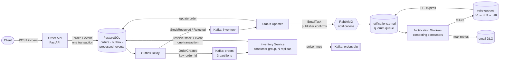

# Event-Driven Order Pipeline

[](https://github.com/sravani551/event-driven-order-pipeline/actions/workflows/ci.yml)


A production-style order processing system that uses **Apache Kafka for event streaming** and
**RabbitMQ for task queues**, built in Python. It focuses on the parts of messaging that are
hard to get right: delivery guarantees, idempotency, ordering, retries, and dead-lettering.



## Why two brokers?

| | Kafka | RabbitMQ |
|---|---|---|
| Used for | Domain **events** (`OrderCreated`, `StockReserved`) | **Tasks** (send this email) |
| Model | Durable, replayable log; consumers track offsets | Queue; messages deleted once acked |
| Scaling | Partitions spread over a consumer group | Competing consumers + `prefetch` |
| Ordering | Per key (order_id → one partition) | Not needed for independent emails |
| Retries | In place with backoff (keeps order), then DLQ topic | Delay queues with TTL, then DLQ |

## Reliability patterns implemented

- **Transactional outbox** – the API writes the order and its `OrderCreated` event in one DB
  transaction; a relay publishes the outbox to Kafka. No "saved but never published" (dual-write) bugs.
- **At-least-once delivery, exactly-once effects** – Kafka auto-commit is off; offsets are
  committed only after the DB transaction commits. Every consumer records `(consumer, event_id)`
  in the same transaction as its side effects, so redelivered messages are skipped.
- **Idempotent producer** – `enable.idempotence=true`, `acks=all`.
- **Per-order ordering** – events keyed by `order_id`; in-place retries block the partition rather
  than skipping ahead.
- **Poison-message handling** – invalid messages go to `orders.dlq` with error + source
  topic/partition/offset headers, so one bad message never stalls a partition.
- **Kafka → RabbitMQ bridge without lost messages** – publish with **publisher confirms** *before*
  committing the DB transaction; the email `task_id` is a deterministic UUIDv5 of the event id,
  so a crash-and-redeliver produces the *same* task, which the worker de-duplicates.
- **Escalating retries in RabbitMQ** – one TTL queue per delay tier (5s → 30s → 2m) dead-letters
  back to the work queue; avoids the head-of-line blocking of per-message TTLs. After the last tier
  the message is parked in a DLQ.
- **Back-pressure** – `prefetch_count` limits unacked messages per worker.
- **Concurrency safety** – `SELECT … FOR UPDATE SKIP LOCKED` for multiple relay replicas; product
  rows locked in sorted order to avoid deadlocks; stock reservation is all-or-nothing.
- **Graceful shutdown** – SIGTERM finishes the in-flight message, commits, and leaves the consumer
  group cleanly (cooperative-sticky rebalancing).
- **API idempotency** – `Idempotency-Key` header makes client retries safe.

## Run it

Requires Docker.

```bash
make up            # or: docker compose up -d --build
make load          # fire 200 orders and measure time-to-settle
curl localhost:8000/stats
```

| URL | What |
|---|---|
| http://localhost:8000/docs | API (Swagger UI) |
| http://localhost:15672 | RabbitMQ management (guest / guest) — watch retry queues fill and drain |
| http://localhost:8080 | Kafka UI (`make up-ui`) — topics, partitions, consumer-group lag |

### Failure scenarios to try

1. **Horizontal scaling** – `make scale` starts 3 inventory consumers; `docker compose logs inventory`
   shows each one being assigned a different partition.
2. **Crash recovery** – `docker compose kill inventory` during `make load`, then start it again.
   No order is lost or double-reserved (check `/products` stock and `/stats`).
3. **Retries and DLQ** – `NOTIFICATION_FAIL_RATE=0.6 make up`, then watch
   `notifications.email.retry.*` and `notifications.email.dlq` in the RabbitMQ UI.
4. **Poison message** – publish garbage to the `orders` topic in Kafka UI and see it land in
   `orders.dlq` with diagnostic headers while the partition keeps flowing.
5. **Broker outage** – `docker compose stop kafka`; orders are still accepted (they wait in the outbox,
   see `outbox_unpublished` in `/stats`) and flow through once Kafka is back.

## Tests

```bash
pip install -r requirements-dev.txt
make test   # 25 unit tests, no brokers needed (SQLite + in-memory fakes)
make e2e    # against the running stack
```

CI (GitHub Actions) runs lint + unit tests, then brings up the whole stack with Docker Compose and
runs the end-to-end check with a 30% simulated email failure rate.

## Design docs

Architecture decisions are recorded as ADRs:

- [0001 – Kafka for domain events, RabbitMQ for tasks](docs/adr/0001-kafka-for-events-rabbitmq-for-tasks.md)
- [0002 – Transactional outbox](docs/adr/0002-transactional-outbox.md)
- [0003 – Idempotent consumers over broker-level exactly-once](docs/adr/0003-idempotent-consumers.md)
- [0004 – Retry and dead-letter strategy](docs/adr/0004-retry-and-dead-letter-strategy.md)

Operations: [runbook](docs/runbook.md): health signals, scaling, DLQ inspection and replay.

## Production hardening (not in scope here)

- Kafka replication factor ≥ 3 with `min.insync.replicas=2`; RabbitMQ cluster of 3 for quorum queues
- Schema registry (Avro/Protobuf) with compatibility checks instead of shared Pydantic models
- Metrics and tracing (Prometheus, OpenTelemetry trace context in message headers)
- Retention jobs for `outbox` and `processed_events`
- TLS/SASL on brokers, secrets from a vault rather than environment variables

## Project layout

```
app/
  api.py                 FastAPI order API (writes order + outbox atomically)
  outbox_relay.py        outbox -> Kafka
  inventory_service.py   Kafka consumer group: reserve stock
  status_updater.py      Kafka consumer -> DB -> RabbitMQ bridge
  notification_worker.py RabbitMQ worker with retry tiers + DLQ
  kafka_utils.py         producer/consumer config, retry + DLQ consumer loop
  rabbit.py              exchanges/queues topology, confirmed publisher
  db.py                  models, outbox + idempotency helpers
  events.py              versioned Pydantic event contracts
  retry.py               pure retry policy
tests/                   unit tests
scripts/                 load test, end-to-end check, DLQ replay tool
docs/                    ADRs and runbook
```
